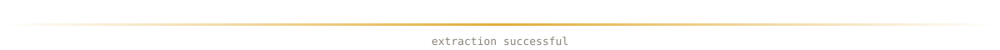

---

## 🎯 What I build

<table>
<tr>
<td width="50%" valign="top">

### 🔫 [Escape From Tarkraft](https://shiftingkill.github.io/escape-from-tarkraft/)
**Owner / developer.** A hardcore, Tarkov-style **extraction shooter inside Minecraft**: modular guns with real ballistics, armor plates, limb-based health, raids on big custom maps, bosses, quests, a hideout, a flea market and player trading.

`Java` · `Fabric 1.21.11` · `Multiplayer` · `Custom maps`

[Modpack](https://modrinth.com/modpack/escape-from-tarkraft) · [Client mod](https://modrinth.com/mod/escape-from-tarkraft-mod) · [Server](https://modrinth.com/server/escape-from-tarkraft-online) · [CurseForge](https://www.curseforge.com/minecraft/modpacks/escape-from-tarkraft)

</td>
<td width="50%" valign="top">

### 📸 [ScreenCap+](https://shiftingkill.github.io/screencap-site/)
A Windows **screenshot tool** on the Microsoft Store: park capture frames over anything, draw on screen, and snap every frame to PNG with one hotkey. No telemetry, works offline.

`Python` · `PySide6 / Qt` · `MSIX` · `Win32`

</td>
</tr>
<tr>
<td width="50%" valign="top">

### 📈 [QuantTrader](https://shiftingkill.github.io/quanttrader-site/)
Futures trading research and automation for NinjaTrader: custom indicators, order-flow tooling and an auto-entry strategy. Overview site is public, code is private.

`C#` · `NinjaScript` · `Python`

</td>
<td width="50%" valign="top">

### 🎁 PhatLoots
Developer of **PhatLoots: Advanced Loot Tables**, a Minecraft server plugin for configurable loot chests and drop tables.

`Java` · `Bukkit / Spigot`

</td>
</tr>
</table>

## 🧰 Toolbox

  

## 🗺️ From the raids

  
  
  

> *A fancy GitHub profile is not a reflection of work ethic.* Most of the work lives in private repos and in-game.

